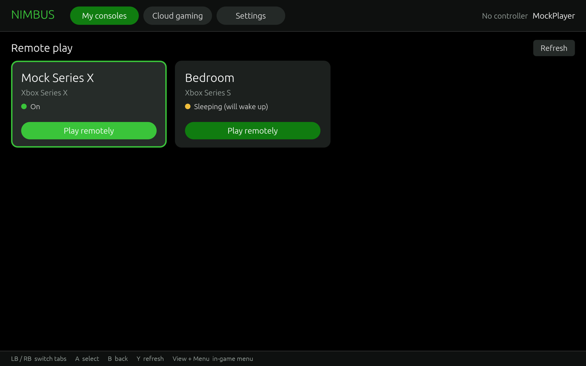
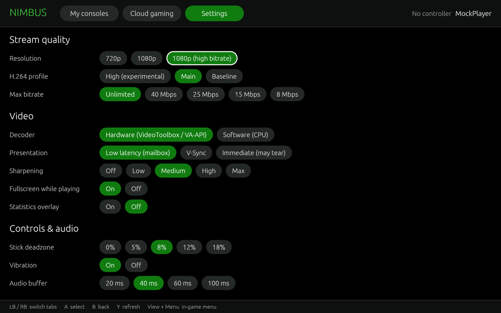

# Nimbus

A native, low-latency **Xbox Remote Play** (stream from your own console) and
**Xbox Cloud Gaming** (xCloud / Game Pass) client for **macOS** and **Linux /
Steam Deck**, written in Rust.

Inspired by [Greenlight](https://github.com/unknownskl/greenlight), but instead
of wrapping the web player in Electron, every stage of the pipeline is native
and tuned for picture quality, frame rate and latency:

```
UDP ─► str0m (WebRTC, sans-IO) ─► H.264 frames ─► FFmpeg (VideoToolbox / VA-API) ─► wgpu (YUV→RGB + sharpening) ─► display
                     ▲                                                                                        
SDL3 controller events ─► input packets (sent immediately, no polling loop)
```

| Consoles | Cloud library | Settings |
|---|---|---|
|  |  |  |

| Streaming with stats (F1) | In-stream menu (View + Menu) | Sign-in |
|---|---|---|
|  |  |  |

*(Screenshots taken against the bundled mock server, which streams a test pattern.)*

## Why it's better than a browser-based client

| | Greenlight (Electron / Chromium WebRTC) | Nimbus |
|---|---|---|
| Resolution / bitrate | 720p or 1080p (`windows` device profile) | **1080p high-bitrate profile by default** (`tizen` device profile, the trick Better xCloud uses) |
| H.264 profile | Main preferred via `setCodecPreferences` | Main preferred too, plus an optional High-profile offer |
| Jitter buffer | Chromium's adaptive playout delay buffer | **none**: a frame goes to the decoder the moment it is complete; losses are repaired with NACK/RTX (TWCC feedback keeps the server's bitrate ramping, as in a browser) |
| Decode | Chromium pipeline (VA-API often disabled on Linux, i.e. software decode on the Deck) | FFmpeg `LOW_DELAY` (one frame in → one frame out), **VideoToolbox / VA-API**, slice-threaded software fallback |
| Presentation | `<video>` / canvas through the browser compositor | dedicated render thread, "latest frame wins" mailbox, selectable mailbox / FIFO(1) / immediate presentation |
| Controller input | `navigator.getGamepads()` polled every 16 ms | **event driven**: each SDL3 controller event is written to the data channel immediately (+16 ms heartbeat), so ~8 ms less input delay on average |
| Packet loss | frozen until a keyframe arrives | same freeze-until-keyframe behaviour (PLI + control message), but resumes after 700 ms if the encoder uses intra refresh instead |
| Image | bilinear scaling | optional contrast-adaptive sharpening (CAS-style) on luma |
| Rumble | dual-motor | dual-motor **+ trigger rumble** (SDL3) |
| Remote play connectivity | host candidates + Teredo | host + Teredo + console direct IPs + **STUN server-reflexive** candidates |
| macOS | — | Game Mode enabled in the app bundle (higher priority, doubled Bluetooth controller polling) |

Measured against the local mock stream (Apple M1, 1080p60 at 14 Mb/s, release
build): about 4 ms VideoToolbox decode (1.3 ms with the software decoder),
15–30 ms from the first packet of a frame to on-screen depending on vsync
phase, and a steady 60 fps with no dropped frames after startup. The stats
overlay (F1) shows the live breakdown (network/queue + decode + render).

## Features

* Microsoft sign-in with a **device code + QR code** (scan it from your phone,
  ideal on a Steam Deck), automatic token refresh.
* **My consoles**: lists consoles with remote features enabled, wakes them from
  sleep, streams with Teredo / direct-IP candidates for out-of-home play.
* **Cloud gaming**: Game Pass Ultimate (or the free-to-play offering) library
  with artwork, search, "jump back in" row, queue / wait-time display.
* Fully **controller-driven UI**: D-pad / stick to move, A select, B back, LB/RB
  to switch tabs, Y to refresh. Big targets, no combo boxes.
* In-stream menu (**View + Menu**, or Esc): resume, **Xbox button** (the
  Steam Deck has no usable guide button), stats, fullscreen, request keyframe,
  disconnect.
* Keyboard fallback when no controller is connected (Greenlight layout:
  Enter=A, Backspace=B, X, Y, arrows=D-pad, WASD=left stick, `[`/`]`=bumpers,
  `-`/`=`=triggers, M=Menu, V=View, N=Nexus).
* Hotkeys: **F1** stats, **F11** fullscreen, **Esc/F10** menu.

## Building

The Rust toolchain is pinned with [mise](https://mise.jdx.dev) (`mise.toml`).

### macOS

```sh
brew install ffmpeg cmake          # FFmpeg for development builds
mise install                       # Rust 1.100
cargo run --release -p nimbus
```

SDL3 is compiled from source and linked statically (needs `cmake`).

Self-contained app bundle (FFmpeg built from source and linked statically):

```sh
packaging/macos/bundle.sh          # → target/Nimbus.app
```

### Linux / Steam Deck

Reproducible x86_64 build in Docker (Ubuntu 22.04 / glibc 2.35, static FFmpeg
with VA-API, static SDL3):

```sh
docker build --platform linux/amd64 -t nimbus-build packaging/linux
docker run --rm --platform linux/amd64 -v "$PWD":/src \
  -v nimbus-cargo:/root/.cargo/registry -v nimbus-target:/src/target nimbus-build
```

This produces `target/release/nimbus` and an AppDir/tarball (or AppImage if
`appimagetool` is installed). The binary only depends on glibc, libva and
libdrm (all present on SteamOS); X11/Wayland/PipeWire are loaded at runtime by
SDL. `packaging/linux/e2e.sh` runs the whole pipeline headless in the same
container (Xvfb + Mesa lavapipe + mock server). On a Steam Deck:

1. Desktop Mode → copy the `nimbus` binary (or AppImage) to e.g. `~/Applications`.
2. Steam → *Add a Non-Steam Game* → pick it.
3. In Gaming Mode, set the controller layout to **Gamepad** (the default for
   non-Steam games is fine). The View + Menu buttons open Nimbus' menu; the
   Steam and "…" buttons stay with Steam.
4. Sign in by scanning the QR code with your phone.

Native build on any distro: install FFmpeg (≥ 5.1) development packages,
`libva-dev`, `cmake`, `clang`, the X11/Wayland/PipeWire headers, then
`cargo build --release -p nimbus` (or `--features static-ffmpeg-linux`).

## Testing without a console: the mock server

`crates/xcloud/examples/mock_server.rs` is a local stand-in for the streaming
backend. It serves the GSSV REST API, answers the WebRTC offer with str0m,
streams a looping H.264 + Opus test file, acknowledges the data-channel
handshake, logs controller input, rumbles when you press **A** and shows a
console dialog when you press **Y**.

```sh
scripts/mock-media.sh                                       # generate test media (ffmpeg)
cargo run -p xcloud --example mock_server -- target/mock-media 8085
NIMBUS_MOCK=http://127.0.0.1:8085 cargo run -p nimbus       # no sign-in needed
```

Debug environment variables:

| Variable | Effect |
|---|---|
| `NIMBUS_MOCK=<url>` | use a mock GSSV server, skip sign-in |
| `NIMBUS_AUTOSTREAM=home` | start streaming the first console automatically |
| `NIMBUS_SCREENSHOT=<png>[,<secs>]` | save a screenshot of the window after a delay |
| `NIMBUS_EXIT_AFTER=<secs>` | quit after a delay |
| `NIMBUS_TEST_NAV=rb,down,activate,wait,back` | replay controller navigation (one step every 400 ms) |
| `NIMBUS_TEST_INPUT=1` | press (A) every second while streaming |
| `NIMBUS_HOME=<dir>` | config/cache directory (default: platform config dir) |
| `NIMBUS_TAB=cloud\|settings` | start on another tab |
| `RUST_LOG=info,xcloud=debug` | verbose protocol logging (SDP, ICE, data channels) |

## Settings

| Setting | Notes |
|---|---|
| Resolution | 720p (`android`), 1080p (`windows`), **1080p high bitrate** (`tizen`) device profiles |
| H.264 profile | Main (default), High (experimental, falls back if the server doesn't offer it), Baseline |
| Max bitrate | `b=AS` cap for slow connections; Unlimited by default |
| Decoder | Hardware (VideoToolbox / VA-API, falls back to software after repeated errors) or Software |
| Presentation | Low latency (mailbox when available, else V-Sync with one frame in flight), V-Sync (two frames, smoothest), Immediate (may tear) |
| Sharpening | contrast-adaptive sharpening strength |
| Stick deadzone, vibration, audio buffer | |

Settings and the account token are stored in the platform config directory
(`~/Library/Application Support/dev.nimbus.Nimbus` on macOS,
`~/.config/nimbus` on Linux). The token file is created with `0600`
permissions.

## Project layout

```
crates/xcloud   protocol library (no UI): auth, GSSV API, catalog, WebRTC session
                (str0m driver on a dedicated mio thread), input/control/message
                channel protocols, ICE/Teredo helpers, mock server example
crates/media    FFmpeg-based H.264 (hardware accelerated) and Opus decoders
crates/nimbus   the app: SDL3 window/controllers/audio, wgpu renderer, egui UI
packaging/      macOS .app bundle script, Linux/Steam Deck Docker build
```

Threads: **main** (SDL events, controllers → network thread), **ui** (egui +
wgpu, app state), **xcloud-net** (WebRTC + data channels, woken instantly via
`mio::Waker`), **video-decode**, **audio**, and two tokio workers for HTTP.

```sh
cargo test --workspace            # protocol, SDP negotiation (real xCloud answer), decoders
cargo test -p nimbus-media --release bench -- --ignored --nocapture   # decoder benchmark
```

## Status and limitations

* The protocol implementation follows Greenlight / xbox-xcloud-player and
  Better xCloud, and is validated against a real captured xCloud SDP answer
  and the local mock server. It hasn't been run against Microsoft's live
  servers yet. Run with `RUST_LOG=info,xcloud=debug` and open an issue with
  the log if something fails.
* Input protocol v7 (1-byte report type) and v8+ are both supported. The
  version is taken from the server's SDP answer.
* Not implemented yet: voice chat (microphone), touch controls, native
  mouse & keyboard input for xCloud titles, multiple accounts.
* Possible next steps: zero-copy VideoToolbox → Metal and VA-API → Vulkan
  (DMA-BUF) texture import, HDR, Flatpak packaging.

Not affiliated with Microsoft. Xbox is a trademark of Microsoft Corporation.
