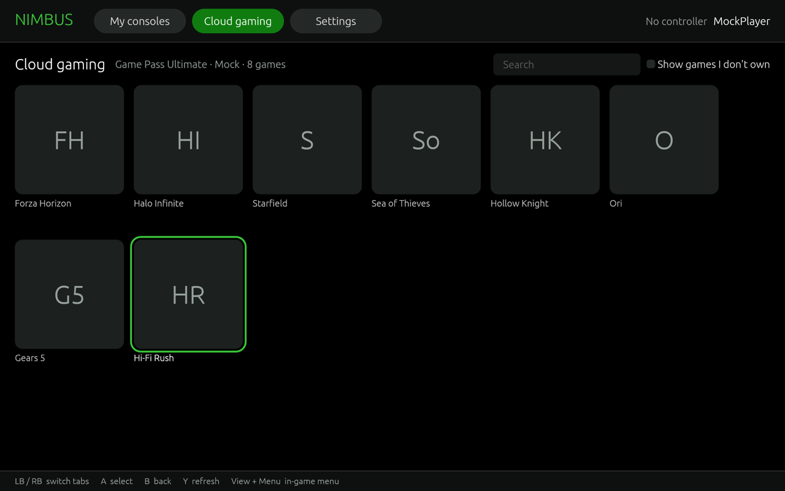
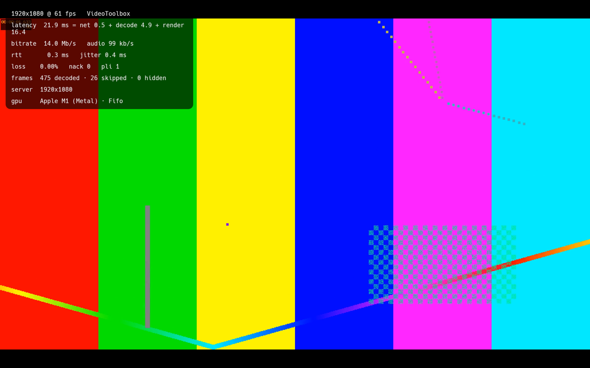
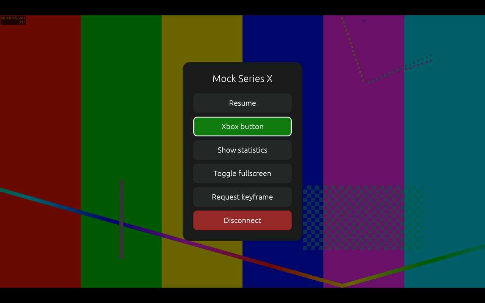
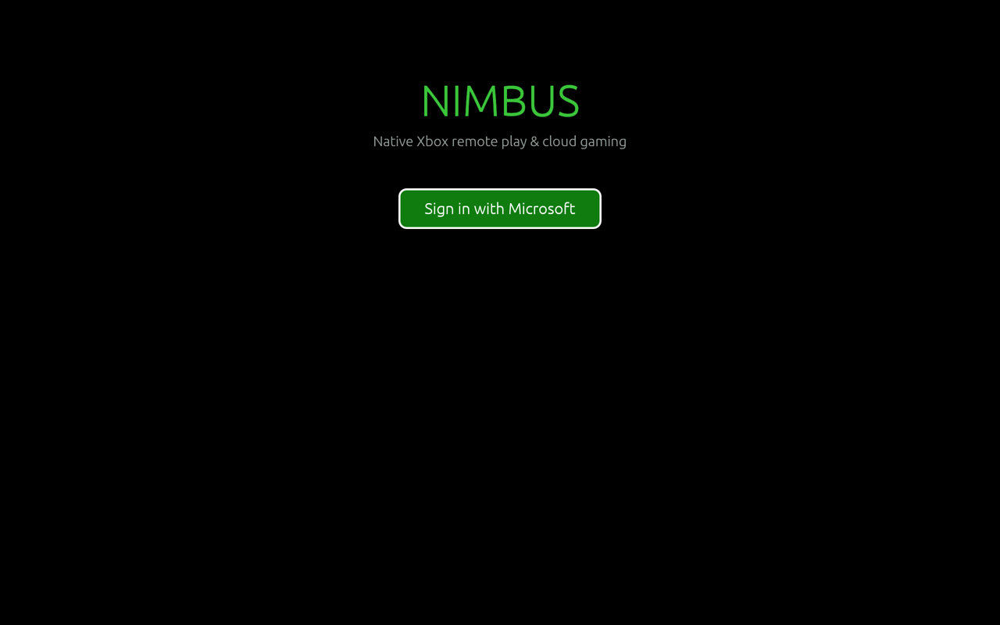

# Nimbus

A native, low-latency **Xbox Remote Play** (stream from your own console) and
**Xbox Cloud Gaming** (xCloud / Game Pass) client for **Apple Silicon Macs**
and the **Steam Deck**, written in Rust. Those are the only supported targets
(other platforms fail at compile time).

Inspired by [Greenlight](https://github.com/unknownskl/greenlight), but instead
of wrapping the web player in Electron, every stage of the pipeline is native
and tuned for picture quality, frame rate and latency:

```
UDP ─► str0m (WebRTC, sans-IO) ─► H.264 frames ─► VideoToolbox (Mac) / VA-API (Deck) ─► wgpu (YUV→RGB + sharpening) ─► display
                     ▲                                                                                        
controller events (gilrs, own thread) ─► input packets (sent immediately, no polling loop)
```

| Consoles | Cloud library | Settings |
|---|---|---|
|  |  |  |

| Streaming with stats (F1) | In-stream menu (View + Menu) | Sign-in |
|---|---|---|
|  |  |  |

*(Screenshots taken against the bundled mock server, which streams a test pattern.)*

## Why it's better than a browser-based client

| | Greenlight (Electron / Chromium WebRTC) | Nimbus |
|---|---|---|
| Resolution / bitrate | 720p or 1080p (`windows` device profile) | **1080p high-bitrate profile by default** (`tizen` device profile, the trick Better xCloud uses) |
| H.264 profile | Main preferred via `setCodecPreferences` | Main preferred too, plus an optional High-profile offer |
| Jitter buffer | Chromium's adaptive playout delay buffer | **none**: a frame goes to the decoder the moment it is complete; losses are repaired with NACK/RTX (TWCC feedback keeps the server's bitrate ramping, as in a browser) |
| Decode | Chromium pipeline (VA-API often disabled on Linux, i.e. software decode on the Deck) | Mac: **VideoToolbox called directly**, decoded frames rendered straight from GPU memory (zero copy). Deck: FFmpeg's H.264 decoder with **VA-API**. One frame in → one frame out, no reorder buffering |
| Presentation | `<video>` / canvas through the browser compositor | dedicated render thread, "latest frame wins" mailbox, selectable mailbox / FIFO(1) / immediate presentation |
| Controller input | `navigator.getGamepads()` polled every 16 ms | **event driven**: a dedicated thread blocks on the controller (IOKit HID on Mac, evdev on the Deck) and each change is written to the data channel immediately (+16 ms heartbeat), so ~8 ms less input delay on average |
| Packet loss | frozen until a keyframe arrives | same freeze-until-keyframe behaviour (PLI + control message), but resumes after 700 ms if the encoder uses intra refresh instead |
| Image | bilinear scaling | optional contrast-adaptive sharpening (CAS-style) on luma |
| Remote play connectivity | host candidates + Teredo | host + Teredo + console direct IPs + **STUN server-reflexive** candidates |
| macOS | — | Game Mode enabled in the app bundle (higher priority, doubled Bluetooth controller polling) |

Measured against the local mock stream (Apple M1, 1080p60 at 14 Mb/s, release
build): about 2 ms VideoToolbox decode with zero-copy rendering,
15–30 ms from the first packet of a frame to on-screen depending on vsync
phase, and a steady 60 fps with no dropped frames after startup. The stats
overlay (F1) shows the live breakdown (network/queue + decode + render).

## Features

* Microsoft sign-in with a **device code + QR code** (scan it from your phone,
  ideal on a Steam Deck), automatic token refresh.
* **My consoles**: lists consoles with remote features enabled, wakes them from
  sleep, streams with Teredo / direct-IP candidates for out-of-home play.
* **Cloud gaming**: Game Pass Ultimate (or the free-to-play offering) library
  with artwork, search, "jump back in" row, queue / wait-time display.
* Fully **controller-driven UI**: D-pad / stick to move, A select, B back, LB/RB
  to switch tabs, Y to refresh. Big targets, no combo boxes.
* In-stream menu (**View + Menu**, or Esc): resume, **Xbox button** (the
  Steam Deck has no usable guide button), stats, fullscreen, request keyframe,
  disconnect.
* Keyboard fallback when no controller is connected (Greenlight layout:
  Enter=A, Backspace=B, X, Y, arrows=D-pad, WASD=left stick, `[`/`]`=bumpers,
  `-`/`=`=triggers, M=Menu, V=View, N=Nexus).
* Hotkeys: **F1** stats, **F11** fullscreen, **Esc/F10** menu.

## Getting started

Everything is managed by [mise](https://mise.jdx.dev): the Rust toolchain and
the test-media tools. No Homebrew, and no C libraries to build on macOS: the
window (winit), controllers (gilrs), audio output (cpal) and Opus decoding are
Rust, and video is decoded by VideoToolbox. On a fresh clone:

```sh
mise trust          # allow this repo's mise.toml
mise install        # Rust + test-media tools
mise run app        # build & run Nimbus
```

The only prerequisite on the Mac is the Xcode Command Line Tools
(`xcode-select --install`). The app only links system frameworks, so it is
self-contained.

`mise tasks` lists everything:

| Task | What it does |
|---|---|
| `mise run app` / `dev` | run Nimbus (release / debug) |
| `mise run build` | release build (`target/release/nimbus`) |
| `mise run test` / `lint` / `fmt` | tests, clippy + rustfmt check, format |
| `mise run bench` | decoder benchmark |
| `mise run mock` | run Nimbus against the local mock server (no account needed) |
| `mise run mock:server` / `mock:media` | just the mock server / regenerate its test media |
| `mise run bundle:macos` | self-contained `target/Nimbus.app` |
| `mise run deck:build` | Steam Deck (x86_64 Linux) release in Docker → `target/deck/` |
| `mise run deck:e2e` | headless Linux end-to-end test in Docker (Xvfb + lavapipe + mock server) |
| `mise run ffmpeg` / `setup` | Steam Deck build only: static FFmpeg (H.264 + VA-API); a no-op on macOS |

Plain `cargo …` commands work too inside a mise-activated shell.

### Steam Deck

`mise run deck:build` (needs Docker, e.g. OrbStack / Docker Desktop) builds in
an Ubuntu 22.04 container (glibc 2.35), using the same mise toolchain plus a
minimal static FFmpeg (H.264 decoder + VA-API, built from source), and
writes `target/deck/nimbus` plus a tarball (and an AppImage when
`appimagetool` is available). The binary only depends on glibc, libva, libdrm,
libudev and libasound (all present on SteamOS; ALSA is routed to PipeWire);
the X11 libraries are loaded at runtime. Then:

1. Desktop Mode → copy `target/deck/nimbus` to e.g. `~/Applications`.
2. Steam → *Add a Non-Steam Game* → pick it.
3. In Gaming Mode use the **Gamepad** controller layout. View + Menu opens
   Nimbus' menu; the Steam and "…" buttons stay with Steam. Steam Input
   presents the Deck's controls (and any PS4/PS5/Switch pad you connect) as a
   virtual Xbox pad; Nimbus skips the physical devices Steam lists in
   `SDL_GAMECONTROLLER_IGNORE_DEVICES`, so nothing shows up twice. Text
   fields open Steam's on-screen keyboard.
4. Sign in by scanning the QR code with your phone.

## Testing without a console: the mock server

`crates/xcloud/examples/mock_server.rs` is a local stand-in for the streaming
backend. It serves the GSSV REST API, answers the WebRTC offer with str0m,
streams a looping H.264 + Opus test file, acknowledges the data-channel
handshake, logs controller input and shows a console dialog when you press
**Y**.

```sh
mise run mock                                   # media + server + app, no sign-in
NIMBUS_AUTOSTREAM=home mise run mock            # …and start streaming right away
```

Debug environment variables:

| Variable | Effect |
|---|---|
| `NIMBUS_MOCK=<url>` | use a mock GSSV server, skip sign-in |
| `NIMBUS_AUTOSTREAM=home` | start streaming the first console automatically |
| `NIMBUS_SCREENSHOT=<png>[,<secs>]` | save a screenshot of the window after a delay |
| `NIMBUS_EXIT_AFTER=<secs>` | quit after a delay |
| `NIMBUS_TEST_NAV=rb,down,activate,wait,back` | replay controller navigation (one step every 400 ms) |
| `NIMBUS_TEST_INPUT=1` | press (A) every second while streaming |
| `NIMBUS_MUTE=1` | never open an audio device (implied by `NIMBUS_SCREENSHOT`, `NIMBUS_EXIT_AFTER` and `NIMBUS_TEST_*`, so automated runs are silent) |
| `NIMBUS_HOME=<dir>` | config/cache directory (default: platform config dir) |
| `NIMBUS_TAB=cloud\|settings` | start on another tab |
| `RUST_LOG=info,xcloud=debug` | verbose protocol logging (SDP, ICE, data channels) |

## Settings

| Setting | Notes |
|---|---|
| Resolution | 720p (`android`), 1080p (`windows`), **1080p high bitrate** (`tizen`) device profiles |
| H.264 profile | Main (default), High (experimental, falls back if the server doesn't offer it), Baseline |
| Max bitrate | `b=AS` cap for slow connections; Unlimited by default |
| Presentation | Low latency (mailbox when available, else V-Sync with one frame in flight), V-Sync (two frames, smoothest), Immediate (may tear) |
| Sharpening | contrast-adaptive sharpening strength |
| Stick deadzone, audio buffer | |

Settings and the account token are stored in the platform config directory
(`~/Library/Application Support/dev.nimbus.Nimbus` on macOS,
`~/.config/nimbus` on Linux). The token file is created with `0600`
permissions.

## Project layout

```
crates/xcloud   protocol library (no UI): auth, GSSV API, catalog, WebRTC session
                (str0m driver on a dedicated mio thread), input/control/message
                channel protocols, ICE/Teredo helpers, mock server example
crates/media    H.264 decoding (VideoToolbox + zero-copy Metal on Mac, FFmpeg/VA-API
                on the Deck) and pure-Rust Opus decoding
crates/nimbus   the app: winit window, gilrs controllers, cpal audio, wgpu renderer,
                egui UI
packaging/      macOS .app bundle script, Linux/Steam Deck Docker build (Dockerfile,
                build.sh, e2e.sh, docker-run.sh)
```

Threads: **main** (winit events; keyboard + controller state → network
thread), **gamepads** (blocks on gilrs, wakes main), **ui** (egui + wgpu, app
state), **xcloud-net** (WebRTC + data channels, woken instantly via
`mio::Waker`), **video-decode**, **audio**, and two tokio workers for HTTP.

```
mise.toml       toolchains, FFMPEG_DIR, tasks
scripts/        build-ffmpeg.sh (Deck build), mock-media.sh, mock.sh
```

## Status and limitations

* The protocol implementation follows Greenlight / xbox-xcloud-player and
  Better xCloud, and is validated against a real captured xCloud SDP answer
  and the local mock server. It hasn't been run against Microsoft's live
  servers yet. Run with `RUST_LOG=info,xcloud=debug` and open an issue with
  the log if something fails.
* Input protocol v7 (1-byte report type) and v8+ are both supported. The
  version is taken from the server's SDP answer.
* Not implemented yet: voice chat (microphone), touch controls, native
  mouse & keyboard input for xCloud titles, multiple accounts.
* No rumble: the controller library (gilrs) can't drive it on macOS.
  Controllers are read through IOKit HID (Mac) / evdev (Deck) with the SDL
  GameControllerDB mappings (Xbox, DualShock 4, DualSense, Switch Pro, …).
* The Steam Deck still uses FFmpeg (H.264 + VA-API only). The pure-Rust
  VA-API option (`cros-codecs`) holds decoded frames until its reference
  buffer fills (up to ~4 frames, ~67 ms at 1080p60), so switching needs a
  patched low-latency output path and testing on real Deck hardware.
* Possible next steps: zero-copy VA-API → Vulkan (DMA-BUF) on the Deck, HDR,
  Flatpak packaging.

Not affiliated with Microsoft. Xbox is a trademark of Microsoft Corporation.
